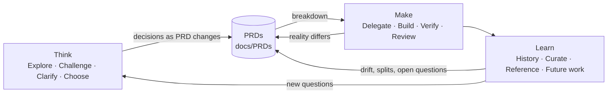

# AI Development Workflow

## Overview

`ai-development` is the successor to `claude-sdd-planner`. It gives a coding agent a working method: decide well (Think), build and prove it (Make), and keep what was learned (Learn). One document type sits at the centre: the **PRD**, a living description of a feature as if it were finished.

No loop is mandatory. Each one is useful on its own, and together they form a workflow:

The workflow lives in **skills** (procedures the agent loads when relevant) and **agents** (specialist roles it delegates to). Both are written once and work in all three harnesses.

### Goals

- **Decide well.** Questions are settled before code is written, the user owns every decision, and each decision lands in the PRD, which stays an accurate picture of the feature.
- **Build and prove it.** Work is broken into tasks whose definition of done is a check that passes. Nothing is done on say-so, and the checks stay runnable as one batch for the life of the feature.
- **Keep what was learned.** Nothing noticed during the work floats: every note, finding, and question ends in a durable home before the work closes.
- **Delegate at the right cost.** The orchestrator keeps judgement and the user conversation; specialists do the execution. Guardrails, not memory, keep it that way.
- **Written once.** One set of skills and agents works in Claude Code, Codex, and OpenCode.

### Non-Goals

- **No mandatory lifecycle.** There's no required sequence of artifacts (research → spec → design → plan) and no approval states gating the move from one to the next. Make's task graph does track each task's status and refuses some transitions (a task is `done` only when its checks pass), but that's execution bookkeeping inside one loop, not a gate on which loop or document comes next.
- **No decision log.** Decisions change the PRD body. History is an optional appendix.
- **No generic router.** Each harness gets its own model routing and guardrails, living in this repo: Claude Code first, OpenCode next, Codex none for now. There's no tier abstraction shared across harnesses.
- **No PRD injection.** Hooks and startup context never preload PRDs or a PRD index. Agents find PRDs by discovery when the task calls for it: scan `docs/PRDs/` frontmatter, and match `code:` paths to the files being touched.

## How It Works

### Moving between loops

There are no commands. The loops are modes the conversation moves through, entered when the work calls for them:

- **Think:** talking through a problem, an idea, a conflict, or a question of scope. Its output is PRD changes.
- **Make:** a request to build something the PRD describes and the code doesn't yet do.
- **Learn:** finishing a piece of work, or a request to check, audit, or clean up.

Moves happen mid-conversation, in any direction. A Make step that hits an unanswered question drops into Think for that question, then returns to building. A Learn audit that finds drift proposes PRD changes and can hand work to Make. The orchestrator says when it moves ("this is a scope question, so thinking it through first") so the user can redirect. It doesn't ask permission to move.

Each loop is an entry skill that sequences its stages, and each stage is its own skill. None of them are user commands: the model picks them up from what's being discussed.

### The PRD contract

A PRD is structured prose with diagrams that describes a whole feature set as it would be if it were finished. The full contract is the `aid-prd` skill. The essentials:

- **The final picture, not history.** It describes what *is*. A decision rewrites the affected section.
- **The first reference.** Questions about scope, responsibility, and behaviour start at the PRD.
- **User-owned, AI-maintained.** Every edit is proposed as a *change fragment* (why, evidence, current text, proposed text, ripple) that the user approves, denies, or edits. Nothing is written silently.
- **Whoever finds a mismatch proposes the fix.** A subagent can't talk to the user, so it returns the fragment in its report and the orchestrator presents it.
- **Unanswered questions belong to the user.** The AI frames, recommends, and records them under `## Open Questions`. It never answers by building.
- **Split, don't sprawl.** Oversized PRDs are carved into children. Scannable frontmatter (`title`, `summary`, `status`, `tags`, `code`, `parent`, `children`, `related`) keeps a growing set navigable, and `code:` paths map files back to the PRDs that govern them.
- **Location.** PRDs live in `docs/PRDs/<FeatureName>-PRD.md` by default.

### Think: the judgement engine

`aid-think` cycles **Explore** (facts with evidence; wide sweeps delegated to the explorer), **Challenge** (conflicts between the user's ideas, documents, and code, stated directly), **Clarify** (one question at a time, each with context, options, and a recommendation; the next question waits for the answer), and **Choose** (the user decides; decisions become PRD fragments). It repeats until nothing open blocks the next step. The user's first answer isn't assumed to be right: conflicts with the evidence are raised once, plainly, and then the user's decision stands.

### Make: delegate, build, verify, review, rebuild

Make opens with a **breakdown**: the path from where the code is now to what the PRD describes. The PRD is the lens. The breakdown never changes what the feature does, only how we get there.

1. **Gap:** what exists, what's missing, and what's wrong, measured against the PRD.
2. **Strategy:** recommended with reasons, chosen by the user:
   - **Map-reduce:** every part is built and tested in isolation, in sequence or in parallel, then an assembly stage puts them together.
   - **Foundation first, then piece by piece:** a minimum path through all the requirements that achieves one real goal end to end. Most of it is shallow or hard-coded, with a few deliberately real pieces. Features are then built on top one by one. Existing code is a foundation already in place.

   The catalog grows, and more strategies will be added.
3. **Plan:** in the chosen strategy's shape. Every step ends in a measurable result (a passing test, a working path, a demo) that moves toward the goal. A step with no observable result isn't a step.

The breakdown is saved as **text**, and the user reviews it as prose. It's a first-pass ordering framework: once approved, the AI builds the **task graph** from it task by task, and it isn't kept in sync after that. From then on, the graph is the working state that Make runs from. Tasks added, split, or reordered mid-Make change the graph, not the text. Each task has an ID, a status (`todo`, `in-progress`, `done`, `blocked`, `dropped`), the tasks it needs, a **footprint** (the files, and where useful the classes or functions, it creates or edits), and a definition of done: the measurable result and the **checks** that prove it, usually the tests written for the task. Checks are commands that run non-interactively from the repository root and pass or fail by exit code, so every task's checks can run together in one batch. A task is `done` only when its checks pass. Because the checks stay attached to their tasks, review re-runs the whole batch (or the batch for the tasks whose footprint a change touched) and shows in one sweep that everything assembled is still green. Nothing tracks staleness; the batch is simply run again. Tasks that are `todo` and whose needs are all `done` form the ready frontier, which drives Delegate. Independent tasks run in parallel.

When implementation uncovers a better path, tasks that no longer apply are **dropped** with a reason, not deleted. They stay in the graph as a record, leave the check batch, and stop counting toward finishing. A task can't be dropped while a `todo`, `in-progress`, or `blocked` task needs it directly: each such dependent is decided first. Its need moves to a replacement, its need is removed because the prerequisite went away, or it's dropped too. When the dependents have dependents of their own, the whole-subtree paths are usually better: reassign every direct dependent to replacements at once, or drop the task together with every `todo`, `in-progress`, or `blocked` task below it. Dependents that are already `done` don't block the drop and aren't reopened: they keep their need on the dropped task as a record of what they were built on, and their checks stay in the batch to show whether the drop broke them. The orchestrator reports each drop and how its dependents were resolved.

Alongside the graph, a **state** record tracks everything that isn't a task in the chain but must be followed to the end: notes, follow-ups, deferred review findings, questions. Each item has an ID, a kind (`note`, `follow-up`, `finding`, `question`), a status (`open` or `resolved`), and a resolution saying where it went: done, made a task, proposed to the PRD, or proposed to project guidance. The work isn't finished while any item is open.

The graph and the state are held by the `aid` tool, a Go binary built from this repo. It defines their schemas, validates both on every load, serialises concurrent writes with a lock file, and refuses to declare the work finished while tasks or state items are open. Each piece of Make work gets a directory named after the PRD it serves: `.aid/<name>/breakdown.md` (the text), `.aid/<name>/tasks.json` (the graph), and `.aid/<name>/state.json` (the state). The lock file is gitignored. All three are committed as work goes, so a crashed session resumes from them. They're working state, not product documentation: the rebuild drops the `.aid/` directory, which is why every state item has to be resolved first.

New seams and component responsibilities go to the PRD's Layout as fragments.

`aid-make` then routes each step to the cheapest capable role with a complete brief, builds inside that scope (stopping on any mismatch rather than improvising), verifies with captured output, and reviews through intent-isolated lenses: **PRD compliance** (diff + PRD: is every described behaviour present and correct?), **goal drift** (the PRD's overview and goals + the built result, with no behaviour sections, breakdown, or graph: does what was built, taken as a whole, achieve what the PRD set out to do?), **quality** (diff + code, no intent), and **fresh eyes** (diff only). Review that can't run in isolated contexts is run serially and labelled as serial.

**When to verify and review.** Reviews are saved for the moments they pay off: key completion gates and particularly complicated bodies of work. Every feature is reviewed before it's approved, and the unit of review is the feature, not the task. Many small per-task reviews cost more and miss the overall context of what's being changed.
1. **While iterating, validate only what the requested change needs.** Run the checks that prove this change works and nothing more. If it's unclear what the change needs, ask.
2. **The formal review lenses always run at the completion gates:** when a feature is complete, when a PR is ready to be created, or when the user asks for a review.
3. **Particularly complicated or high-risk work earns a review before the gate.** The orchestrator actively proposes one when the work warrants it, and the user approves.
4. **Project reviewer agents run on completed features they're built for.** Their descriptions say what they cover (e.g. SQL migrations), and they join the formal review alongside the built-in lenses.

Make closes with a **rebuild** once the changes are complete. Building leaves a trail of small commits, review fixes, and progress updates. The rebuild squashes that iteration and noise into a presentable history, organised feature by feature, for whoever reviews the PR or merge. Readability is the main goal, and bisectability is not the primary use case. Commits that build on their own are preferred where practical, but that isn't always possible, especially on long projects. The final tree must match the original exactly.

### Learn: history, curate, reference, future work

`aid-learn` audits PRDs against code (drift, hygiene, split candidates, stale questions), keeps reference material sourced and linked from PRDs, and makes sure follow-ups never float. Work that's part of the final picture is already tracked by the PRD-versus-code gap, and work that isn't is an open question.

**History** closes out a piece of Make work before the rebuild drops its `.aid/` directory. It walks every open state item with the user, one at a time, and resolves each: done, made a task, proposed to the PRD, or proposed to project guidance. It then summarises what was learned. What survives the rebuild is the PRD, the project guidance, and the feature commits; the working state doesn't.

## Layout

| Component | Location | Owns |
|---|---|---|
| Skills | `skills/aid-*/SKILL.md` (+ `references/`) | The procedures, canonical and consumed unmodified by every harness. The root `aid-orchestrate`; the contract `aid-prd`; the tool guides `aid-graph` (the task graph) and `aid-state` (state items), covering how to drive the `aid` binary: commands, file formats, and usage patterns; the loop entry points `aid-think`, `aid-make`, `aid-learn`; and stage skills named `aid-<loop>-<stage>` (e.g. `aid-think-challenge`, `aid-make-breakdown`), each loaded by its loop. |
| Agents | `agents/aid-*.md` | The roster. Claude-native frontmatter (including `model`) plus the neutral keys `loop`, `readOnly`, `capabilities`, `primary`. |
| Harness config | `config/harness.json` | The name prefix, plus per-harness mappings: OpenCode `mode` and permissions, Codex sandbox. |
| Generator | `tools/plugin-compiler/` | A Go tool: validation, the manifests, and per-harness agent files. `--check` is the drift gate. Nothing in the repo's tooling or tests needs Node; `index.js` is the only JavaScript, because OpenCode's plugin entry must be. |
| Task tool | `cmd/aid/`, `internal/` | The `aid` Go binary: the `tasks.json` and `state.json` schemas, validation, the write lock, running tasks' checks in batch, and the finish check. Installed with `go install github.com/danweinerdev/ai-devtools/cmd/aid@latest` (or `make install-aid` from a checkout); release downloads fetched on first use are planned. `make check` runs its tests. |
| Go module | `go.mod` | `github.com/danweinerdev/ai-devtools`, the public repository. One module for the `aid` binary and the repo's tools, so they share `internal/` code and one `go test ./...`. Requires Go 1.26.10. |
| Registries | `skills-manifest.json`, `agents-manifest.json` | Generated, harness-neutral indexes read by the OpenCode entry and the guards. |
| Harness agents | `dist/opencode/agents/*.md`, `dist/codex/agents/*.toml` | Generated. |
| Claude Code | `.claude-plugin/plugin.json` | The plugin manifest. `skills/` and `agents/` are discovered from the root. |
| Codex | `.codex-plugin/plugin.json` | The manifest with `"skills": "./skills/"`. Agents can't be declared in a Codex plugin, so they install as files. |
| OpenCode | `index.js`, `package.json` | The V2 plugin entry (`setup` registers skills in place). Agents install as files. |
| Claude guardrails | `harness/claude/`, `internal/guard/` | `hooks.json`, wired in through `.claude-plugin/plugin.json` `hooks`, runs `aid guard <name>` for each guard and for the routing policy injected at session start. The guards live in the `aid` binary with Go tests, so the plugin has no Python or other runtime dependency; the hooks need `aid` on the PATH. A missing binary makes the hooks error, which the harness treats as non-blocking, so the guards fail open until `aid` is installed. |
| OpenCode guardrails | `harness/opencode/` | The model router, ported to the V2 plugin API (planned). |
| Installer | `scripts/install.sh`, `make install-*` | Symlinks generated agents into `$CODEX_HOME/agents` or `~/.config/opencode/agents`. |

## Features

### Cross-harness packaging

One source, three harnesses, and no prose transformation.

- **One skill tree:** every harness loads `skills/` in place. Skill bodies are written harness-neutrally, never naming harness-specific tools as requirements, and must stay correct when there are no subagents (the primary agent plays each role in turn).
- **Globally unique names:** skills and agents carry the `aid-` prefix everywhere, because Codex and OpenCode share one global namespace. In Claude Code they also appear under the plugin namespace (`ai-development:aid-think`).
- **Agents generated from one definition:** Claude Code reads `agents/*.md` directly. The build emits OpenCode markdown agents (`mode: subagent`, or `primary` for the orchestrator, which is generated from the `aid-orchestrate` skill; read-only maps to `permission.edit: deny`) and Codex role TOML (`developer_instructions`; read-only maps to `sandbox_mode = "read-only"`).
- **Drift gate:** `make check` fails when frontmatter is invalid, when an `aid-*` reference names a skill or agent that doesn't exist, or when generated files differ from a fresh build.
- **Models are native to each harness:** Claude agents carry `model:` in frontmatter, OpenCode models come from the OpenCode router config keyed by agent name, and Codex agents inherit the session model.

### Orchestration

The orchestration rules (the PRD gate, briefing, synthesis, honest reporting, routing to the roster) live in one place: the `aid-orchestrate` skill. Each harness turns its root into the orchestrator its own way.

| Harness | The orchestrator | How it gets the rules |
|---|---|---|
| Claude Code | the main conversation | injected at session start (and after compaction) by the guardrails' startup hook; `aid-orchestrate` re-anchors them in long sessions |
| OpenCode | `aid-orchestrator`, a primary agent and the one to run | the agent is generated from the `aid-orchestrate` skill body |
| Codex | the main thread | the `aid-orchestrate` skill |

The orchestrator is never a subagent. Claude has no `aid-orchestrator` agent file, and the guards deny spawning one.

### The agent roster

| Agent | Loop | Claude model | Role |
|---|---|---|---|
| `aid-orchestrator` | all | (main conversation) | The root. Holds judgement, the user conversation, and the PRD gate. Delegates and synthesises. See Orchestration for how each harness forms it. |
| `aid-explorer` | think | `haiku` | Read-only research: evidence-backed findings, conflicts, search trails. |
| `aid-mechanic` | make | `sonnet` | Well-specified technical building. Stops on mismatch. |
| `aid-oracle` | make | `opus` | High-risk or novel implementation, and independent single-lens review. |
| `aid-designer` | think | `opus` | Visual and UX direction and design review. No production code. |
| `aid-creator` | make | `sonnet` | First-pass creative work, clearly marked with its soft spots. |
| `aid-craftsman` | make | `opus` | Complex refinement of a working first pass into a finished one. |

Every specialist report includes a `## PRD changes proposed` section, which is how R2 ("whoever finds an inconsistency proposes the fix") works across the subagent boundary.

### Guardrails (Claude Code)

Always on. The guardrails make the roster the only way work gets delegated.

- **No generic delegation:** spawns of `general-purpose`, `Explore`, `Plan`, `claude`, or an agent call with no type are denied, with a pointer to the matching `aid-*` role. Generic agents run at the orchestrator's model, so delegating to them is delegating at orchestration cost.
- **Roster agents aren't gated:** any `aid-*` agent, including `aid-oracle`, can be spawned directly. The oracle is a deliberate role, not an escalation fallback, so it needs no failed cheaper attempt first.
- **Inline exploration budget:** after a set number of search-type calls in one user turn (default 20), further calls are denied with a pointer to `aid-explorer`. Verification commands (tests, linters, `git log`/`show`, process inspection), reads under `docs/PRDs/` or `.aid/`, and `aid` tool calls don't count against it. Delegating resets the count.
- **Sensitivity gate:** opt-in, per project, and off when not configured. Each rule names patterns or paths and the agents allowed to receive matching content. A spawn carrying matching content is denied unless the target agent is allowed. Patterns are RE2 regular expressions (no lookahead or lookbehind), which match in linear time on every spawn; a pattern RE2 can't compile is a configuration error.
- **Routing policy:** injected at session start. It says which role does what, when work stays in the main loop, and what replaces each built-in: `general-purpose` → the matching `aid-*` role, `Explore` → `aid-explorer`, `Plan` → the main loop with `aid-think`/`aid-make-breakdown`. It also points the orchestrator at project agents to discover.
- **Project agents:** agents in the project's `.claude/agents/*.md` are first-class routing targets, discovered when needed. A project agent whose description marks it as a reviewer joins `aid-make` Review as an extra lens alongside the built-in four. Its own `model:` is its default.
- **Per-project configuration:** an optional `.claude/aid.json` holds three keys, each optional:
  - `models` (`{"<agent>": "<model>"}`) overrides the model for any agent, project or `aid-*`. A guard enforces it by rewriting `model` on the spawn (an input update that also approves the spawn), so it doesn't depend on the orchestrator remembering. Generic agents stay blocked whatever this file says.
  - `guards` sets `inline_budget` (default 20) and `exempt_verification` (default true).
  - `sensitive` holds the sensitivity gate's rules (name, patterns, paths, allowed agents).
- **Bad configuration fails loudly:** `.claude/aid.json` is validated strictly: it must parse, unknown keys are rejected with a did-you-mean, and values must have the right types, valid patterns, and known models. When it's invalid, the session-start policy reports the errors, and every guard that reads the file denies its call with the same message saying what to fix. A bad config is never ignored or partly applied.
- **Escape hatch:** `AID_GUARDS=off` disables the guards for one session. A bug in a guard's own code still fails open (allow, with a note on stderr), so a guard defect never wedges a session. That case is distinct from a bad configuration, which is the user's to fix.

### Guardrails (OpenCode)

The same intent, implemented natively in the OpenCode plugin, with guards through the V2 hook API. The agent-to-model mapping stays in `model-router.json`: named model slots, plus an `agents` map from agent name to slot. *(Planned. The current router targets the V1 API.)*

## Interfaces

- **Skill frontmatter:** `name` (equals the directory, `aid-` prefix, and stage skills `aid-<loop>-<stage>`) and `description` (1024 characters or fewer, starting with what the skill does, followed by when to use it). A stage's description also names the loop that loads it and says it's not an entry point. No skill is a user command: each is hidden from user menus where the harness supports that (Claude `user-invocable: false`; Codex and OpenCode equivalents still to be verified). The body declares `**Loop:** think|make|learn|all`.
- **Agent frontmatter:** `name` and `description`; `loop`; `model` (Claude: `haiku`, `sonnet`, `opus`, `fable`, or `inherit`; other harnesses ignore it); `readOnly` (when true, `disallowedTools` must include Write and Edit); `capabilities`; optional Claude-only keys such as `disallowedTools`.
- **The `aid` tool:** each command acts on one piece of work, `.aid/<name>/`; `--work <name>` selects it and can be left out when only one exists. Every command validates each file it loads (schema version, no unknown keys, unique IDs, no dangling needs, no cycles), and every write is locked and atomic. `show`, `validate`, and `finish` load both files, and `validate` also checks across them: an item resolved as a task must name a task that exists. `--json` gives machine-readable output. `aid` stores no commit IDs and never calls git, so rebasing or cherry-picking work back from a worktree invalidates nothing.
  - **Graph** (guide: `aid-graph`): `init` creates the directory. `add-task`, `split-task` (replaces a task that isn't `done` with parts added beforehand: the parts inherit its needs, anything that needed it now needs all of them, and it becomes `dropped` with the reason "split into …"; refused when a part is something the task itself needs, directly or through a chain), and `update-task` (title, needs, footprint, definition of done, checks) edit the shape. Status changes only through `claim-task` (`in-progress`, with a holder and a lease; one holder at a time, and the holder claiming again renews the lease), `release-task` (back to `todo`; a lapsed lease releases itself; on a `blocked` task it unblocks it, the only way out of `blocked`), `complete-task` (runs the task's checks and marks it `done` only if they pass and the caller is still the holder), `block-task` (`blocked`, with a reason; a live claim can only be blocked by its holder), and `drop-task` (`dropped`, with a reason; refused while a claim is live, and refused while any `todo`, `in-progress`, or `blocked` task still needs it directly. A refusal returns the direct dependents, each with its ID, status, and whether it blocks, plus a count of the live tasks below them, so the next call can act on them directly. `--replaced-by <ids>` moves every blocking direct dependent's need onto the replacements in the same write; `--cascade` drops the task and every `todo`, `in-progress`, or `blocked` task that needs it transitively, refused while any of them holds a live claim. `done` dependents keep their need either way). `check` runs the checks of every task, or with `--paths <file>…` only those whose footprint includes the given files, and reports pass or fail per task. A given path no task covers is listed but passes, since unowned files (often docs) need no re-proving; `--strict` makes any such path fail the run. `ready` lists the frontier, `show` prints the graph or, given IDs, those tasks in full, and `validate` checks without writing. The commands that change status take the caller's identity as `--holder`, which defaults to `$AID_HOLDER`, else `main`: a lone agent never passes it, and delegated workers pass their role. An `in-progress` task's needs must all be `done`, like a `done` task's, so no edit can leave a holder waiting on unfinished work: `update-task`, `split-task`, and `drop-task --replaced-by` refuse such a rewiring, and the task is released first.
  - **State** (guide: `aid-state`): `add-item`, `update-item`, `resolve-item` (records where it went: done, a task, the PRD, or project guidance), and `items` (filterable by kind and status).
  - **`finish`** checks, inside the same locked write, that the graph has at least one task, every task is `done` or `dropped`, no claims are live, and no state item is open. It refuses and lists what's left otherwise; an empty graph is refused as a graph that was never built.
- **Change fragment:** the format defined in `aid-prd` R1.
- **Specialist report:** each agent defines its own sections, and all of them include `## PRD changes proposed`.

## Open Questions

- **OpenCode router upgrade.** Port `opencode-model-router` to the V2 plugin API, merge it into `index.js`, and give it a face lift around the `aid-*` agents, keeping `model-router.json` as the agent-to-model mapping.
- **Codex routing.** None for now. Revisit if Codex gains plugin-declared agents or a hook that can guard spawns.
- **Unverified details.** The OpenCode V2 `setup`/`skill.transform` entry, Codex's `sandbox_mode` in role TOML, and Claude ignoring the neutral frontmatter keys are written from docs and haven't been exercised in a live session yet. The `aid` tool's Windows paths (the `LockFileEx` lock, the rename retry, the Job Object that kills a check's process tree, and signal handling) compile and pass `vet` but haven't run on Windows.

## Appendix: History

- 2026-10-27: Initial draft, synthesised from the user's concept notes and `claude-sdd-planner` history (see `docs/history/sdd-planner-lessons.md`).
