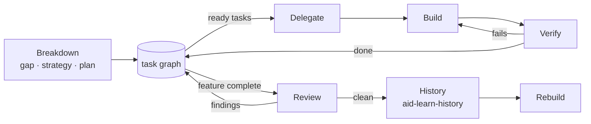

# Make: delegate, build, verify, review, rebuild

**Loop:** make

Make turns decided work into verified, reviewed changes. The orchestrator owns judgement, integration, and the working state. Specialists do the work.

## Preconditions

- The work traces to a PRD section. Work that traces to nothing is cut, or sent to aid-think first.
- No `## Open Questions` gate this piece. Gated work is refused, not built provisionally (aid-prd R3).

## Stages

| Stage | Skill | Works from | Result |
|---|---|---|---|
| Breakdown | aid-make-breakdown | a PRD with no open question gating this piece | the reviewed breakdown text, then the task graph built from it |
| Delegate | aid-make-delegate | the graph's ready frontier | each ready task claimed and routed with a complete brief |
| Build | aid-make-build | a brief | the change, inside the brief's scope |
| Verify | aid-make-verify | the change and the task's checks | the task's checks passing, output captured; the task `done` |
| Review | aid-make-review | a complete feature, and each lens's inputs | intent-isolated lenses at the completion gates |
| Rebuild | aid-make-rebuild | reviewed work whose state items are resolved (aid-learn-history) | a presentable feature-by-feature history |

These stages are a toolbox, not a map. Pick the one the situation calls for, skip or revisit any of them, and when the next step isn't obvious, suggest one or ask the user what they want to do. "Works from" says what each stage needs: skipping the stage that produces it is a choice to make knowingly, and to say out loud. Order that matters for correctness is enforced by `aid`, not by this table: a task is `done` only when its checks pass, and `finish` refuses while anything is open.

Delegate, Build, and Verify repeat over the ready frontier (aid-graph) until the feature is complete. Independent tasks run in parallel; tasks whose footprints overlap run in sequence.

## Working state

Each piece of Make work keeps its state in `.aid/<name>/`, named after the PRD it serves: the breakdown text, the task graph (aid-graph), and the state record (aid-state). It's committed as work goes, so a crashed session resumes from it: read the graph and the open state items, then continue from the ready frontier. Anything noticed along the way that isn't a task (a note, a follow-up, a deferred finding, a question) goes into the state record straight away, so nothing floats.

## Finishing

When review is clean, aid-learn-history resolves every open state item with the user, and the tool's finish check must pass. Then aid-make-rebuild rewrites the history and drops `.aid/`. Before calling the work done, check that the governing PRD still describes reality. If the build changed the picture, propose the fragments (aid-prd R2).
