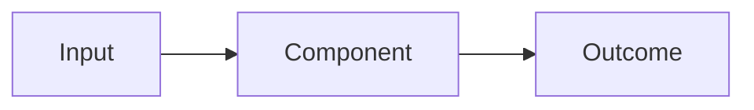

# <Feature Name>

## Overview

<What this is and why it exists, written as if the feature already ships.>

### Non-Goals

- <Things this feature deliberately does not do.>

## How It Works

<The end-to-end story. Lead with a diagram.>

## Layout

| Component | Location | Owns |
|---|---|---|
| <name> | `<path>` | <responsibility> |

<Note any seam that deserves its own crate, package, or module, and why.>

## Features

### <Feature A>

<What it does, in prose.>

- **<Behaviour A1>:** <observable behaviour, testable on its own outside the main app or UI>
- **<Behaviour A2>:** <...>

### <Feature B>

...

## Interfaces

<Contracts between components and with the outside world: APIs, file formats, events, CLI surfaces.>

## Open Questions

- **<Question>**: <context>. Options: <a> / <b>. Recommendation: <a, because ...>.

## Appendix: History

- <YYYY-MM-DD>: <what changed in the picture and why. Optional.>
