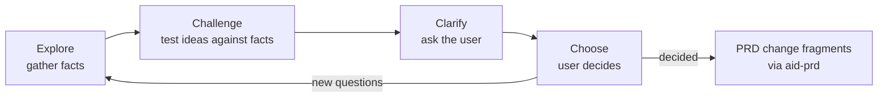

# Think: Explore, Challenge, Clarify, Choose

**Loop:** think

Think turns an unclear situation into decisions the user has made, recorded as PRD changes. It's a cycle, not a pipeline. Run it as many times as the problem needs, and stop when nothing open is blocking the next move or when the user stops.

The output is never "a plan the AI picked". It's the user's decisions, written into the PRD as approved fragments (aid-prd R1), plus whatever stays open, listed under `## Open Questions`.

## Stages

| Stage | Skill | Works from | Produces |
|---|---|---|---|
| Explore | aid-think-explore | the question, the PRD, the code | a fact sheet: claims with evidence |
| Challenge | aid-think-challenge | Explore's fact sheet (or, for the adversarial PRD challenge, the PRD and its lenses' inputs) | conflicts, contradictions, gaps, hidden scope, risk |
| Clarify | aid-think-clarify | Challenge's ranked list, or any open question | the user's answers, one question at a time |
| Choose | aid-think-choose | the user's answers | PRD change fragments and open questions |

These stages are a toolbox, not a map. Pick the one the situation calls for, skip or revisit any of them, and when the next step isn't obvious, suggest one or ask the user what they want to do. "Works from" says what each stage needs: skipping the stage that produces it is a choice to make knowingly, and to say out loud. An answer in Clarify often sends you back to Explore. What doesn't bend is the ground rules below.

## Ground rules: the judgement engine

These hold in every stage.

1. **The PRD comes first.** Find and read the relevant PRD before anything else (discovery: `docs/PRDs/` frontmatter and `code:` paths). If there isn't one, say so. Creating one is a Choose outcome, not an assumption.
2. **Facts carry evidence.** Every factual claim names its source: file:line, a command and its output, a doc and section, a URL with an as-of date. Recalled knowledge is labelled as recalled.
3. **Rank the evidence.** Running code and tests beat code reading, which beats docs, which beat plans, which beat memory. When sources conflict, the conflict is itself a finding.
4. **Absence needs a search trail.** "X doesn't exist" means you list what you searched, where, and how. One empty grep proves nothing.
5. **Check the premise.** Before answering a question, check whether its premise holds. Questions often carry an assumption the facts contradict.
6. **Don't assume the user's first answer is right.** The user owns the decision, not the facts. If an answer conflicts with the evidence, say so plainly with the evidence, once. Then accept the decision.
7. **The user answers unanswered questions** (aid-prd R3). You frame, recommend, and record. You never decide by building it.

## Ending a Think session

Close with a short summary:
- decisions made, each with the fragment that recorded it, applied or pending approval;
- conflicts resolved, and any still open;
- open questions, now in the PRD;
- the suggested next step. Building a settled PRD is aid-make, which opens with aid-make-breakdown.
